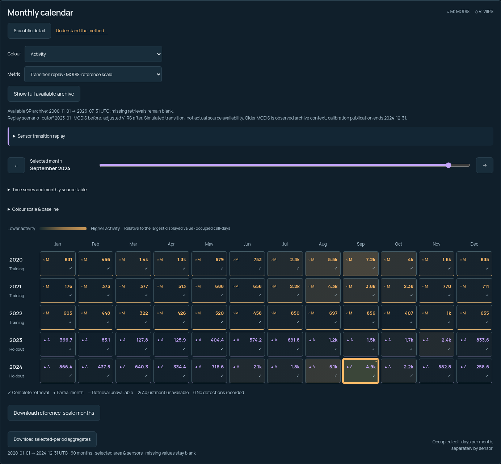

# Ember Atlas

**Explore comparable fire activity across MODIS and VIIRS.**

Ember Atlas is a geographic dashboard for the NASA Space Apps Challenge, **“Harmonization of MODIS and VIIRS Hot Spots.”** It combines real NASA FIRMS observations, a source-labeled activity calendar and reproducible downloads across eight study areas.

[Explore the app](https://ember-atlas-opal.vercel.app/) · [Guided demo](https://ember-atlas-opal.vercel.app/demo?region=pantanal&view=replay&benchmark=1&month=2024-09) · [Pitch](https://ember-atlas-opal.vercel.app/pitch) · [Methods & data](https://ember-atlas-opal.vercel.app/methods) · [About](https://ember-atlas-opal.vercel.app/about)

[Run locally](#run-locally) · [Validation](#measured-sensor-agreement) · [Coverage](#regions-and-released-coverage) · [Methodology](docs/methodology.md)

[](https://ember-atlas-opal.vercel.app/demo?region=pantanal&view=replay&benchmark=1&month=2024-09)

*Actual product view using released observations. The map shows occupied UTC days per grid cell; the comparison uses monthly occupied cell-days.*

## What you can do

- Explore eight study areas on an interactive, attributed map with zoom, pan, scale and a local geographic fallback.
- Select a month, area and sensor; inspect the matching calendar, comparison, historical context and observations.
- Follow five guided scenes, replay a source change and reveal continuing MODIS observations as a separate benchmark.
- Inspect full-data grid occupancy or a clearly labeled sample of individual detections.
- Download observations, monthly aggregates, occupied-day cells, reference-scale months and a provenance manifest.
- Share the selected analytical state through its URL, including optional scientific detail.

The public app reads versioned snapshots. Visitors need no account, FIRMS key or live FIRMS connection. All sixteen initial SP/NRT observation views and aggregate history are served locally; additional historical observation shards use immutable public GitHub URLs with SHA-256 verification. External map tiles have an attributed local fallback.

## Start with the Pantanal case

1. Open the [September 2024 walkthrough](https://ember-atlas-opal.vercel.app/demo?region=pantanal&view=replay&benchmark=1&month=2024-09).
2. Compare **5,819 MODIS**, **8,809 common-grid VIIRS** and **4,879.1 adjusted VIIRS** occupied cell-days. The adjustment remains **16.2% below MODIS** that month.
3. Compare December 2022 with January 2023. The replay uses observed MODIS before the cutoff and adjusted NOAA-20 VIIRS afterward. January 2023 is a **replay scenario**; MODIS observations actually continue.
4. Inspect the same-month historical baseline, including its earlier years, sample size and coverage. The selected year and future years are excluded.
5. Export the evidence, then change the region or filters. Map, comparison and downloads follow the same selected study mask and UTC scope.

## Measured sensor agreement

The original Pantanal evaluation uses **36 training months in 2020–2022** and **24 separate holdout months in 2023–2024**, over the full Pantanal study area. All three methods use the same paired months and units.

| Method | Holdout MAE ↓ | Signed bias |
| --- | ---: | ---: |
| Unadjusted VIIRS on the common grid | 1,021.7 | +1,021.7 |
| Training-only scalar | **175.3** | −54.3 |
| Published frozen quarterly factors | 199.7 | −124.0 |

**Units: occupied cell-days per month.** The frozen quarterly adjustment reduces MAE by **80.5% against unadjusted common-grid VIIRS**. The scalar performs better on this holdout and remains visible in the comparison. The published Pantanal method was retained; selecting a replacement requires a separate evaluation protocol.

The scalar minimizes training-only squared monthly residuals through the origin: `a = sum(VIIRS × MODIS) / sum(VIIRS²)`, giving `a = 0.5497999782`. Quarterly factors preserve the corresponding training-quarter totals, with the documented pooled fallback.

Peak-month residuals also remain visible. The six most active holdout months are selected by observed MODIS cell-days, independently of candidate errors. Their scalar/quarterly MAE is **404.6 / 534.6** cell-days per month. See the [three-method artifact](web/data/replay-evaluation-7d4268256831.json) and [all monthly residuals](https://ember-atlas-opal.vercel.app/data/replay-residuals.csv).

**Interpretation:** MODIS is the comparison reference. Ground-truth accuracy and usable satellite observation opportunity are unmeasured. Reported MODIS version labels change from `6.03` in training to `61.03` in evaluation; physical processing homogeneity remains unverified. The results describe agreement with MODIS_SP as delivered, without isolating sensor effects. Literal versions and source-type flags are preserved in current exports.

## Regions and released coverage

Presets appear in this order: [Pantanal](https://ember-atlas-opal.vercel.app/?region=pantanal), [Southern Amazon](https://ember-atlas-opal.vercel.app/?region=southern-amazon), [Cerrado](https://ember-atlas-opal.vercel.app/?region=cerrado), [Gran Chaco](https://ember-atlas-opal.vercel.app/?region=gran-chaco), [California](https://ember-atlas-opal.vercel.app/?region=california), [Southeastern Australia](https://ember-atlas-opal.vercel.app/?region=southeastern-australia), [Iberian Peninsula](https://ember-atlas-opal.vercel.app/?region=iberian-peninsula) and [Siberia](https://ember-atlas-opal.vercel.app/?region=siberia).

| Released view | Products | Observed UTC coverage |
| --- | --- | --- |
| Paired archive, all eight areas | `MODIS_SP`, `VIIRS_NOAA20_SP` | January 2020–July 2026 · 79 complete paired months |
| Extended Pantanal archive | `MODIS_SP` | November 2000–July 2026 |
| Recent detections, all eight areas | `MODIS_NRT` | September 1–November 14, 2026 |
| Recent detections, all eight areas | `VIIRS_NOAA20_NRT` | August 1–November 14, 2026 |

These dates describe the frozen release snapshot. The default NRT selection is November 8–14 UTC. SP and NRT remain separate because the captured availability provides no same-sensor overlap for evaluating a join.

Every preset is an explicitly bounded **WGS84 study rectangle**. The [region registry](data/region-definitions-v1.json) defines the geometry; the [published registry](https://ember-atlas-opal.vercel.app/data/regions.json) resolves the current products and versioned artifacts. Siberia means 60–140°E, 50–72°N; Southeastern Australia means 140–154°E, 44–28°S, including Tasmania. These rectangles are analytical masks, rather than official biome or state boundaries.

<details>
<summary>Eight-area inventory: exact bounds, product dates and retrieved days</summary>

<!-- COVERAGE:START -->
| Study area (W/S/E/N) | Observed SP coverage | Recent NRT UTC window | Adjustment |
| --- | --- | --- | --- |
| Pantanal (-59, -23, -54, -15) | MODIS_SP: 2000-11-01–2026-07-31 (9404 retrieved days); VIIRS_NOAA20_SP: 2020-01-01–2026-07-31 (2404 retrieved days) | MODIS_NRT: 2026-09-01–2026-11-14 (75 retrieved days); VIIRS_NOAA20_NRT: 2026-08-01–2026-11-14 (106 retrieved days) | Evaluated full area, SP 2020–2024 only |
| Southern Amazon (-65, -13, -48, -5) | MODIS_SP: 2020-01-01–2026-07-31 (2404 retrieved days); VIIRS_NOAA20_SP: 2020-01-01–2026-07-31 (2404 retrieved days) | MODIS_NRT: 2026-09-01–2026-11-14 (75 retrieved days); VIIRS_NOAA20_NRT: 2026-08-01–2026-11-14 (106 retrieved days) | Evaluated seasonal, full area SP through 2026-07-31 |
| Cerrado (-55, -20, -44, -8) | MODIS_SP: 2020-01-01–2026-07-31 (2404 retrieved days); VIIRS_NOAA20_SP: 2020-01-01–2026-07-31 (2404 retrieved days) | MODIS_NRT: 2026-09-01–2026-11-14 (75 retrieved days); VIIRS_NOAA20_NRT: 2026-08-01–2026-11-14 (106 retrieved days) | Evaluated seasonal, full area SP through 2026-07-31 |
| Gran Chaco (-66, -32, -57, -17) | MODIS_SP: 2020-01-01–2026-07-31 (2404 retrieved days); VIIRS_NOAA20_SP: 2020-01-01–2026-07-31 (2404 retrieved days) | MODIS_NRT: 2026-09-01–2026-11-14 (75 retrieved days); VIIRS_NOAA20_NRT: 2026-08-01–2026-11-14 (106 retrieved days) | Evaluated seasonal, full area SP through 2026-07-31 |
| California (-125, 32, -114, 42.5) | MODIS_SP: 2020-01-01–2026-07-31 (2404 retrieved days); VIIRS_NOAA20_SP: 2020-01-01–2026-07-31 (2404 retrieved days) | MODIS_NRT: 2026-09-01–2026-11-14 (75 retrieved days); VIIRS_NOAA20_NRT: 2026-08-01–2026-11-14 (106 retrieved days) | Evaluated seasonal, full area SP through 2026-07-31 |
| Southeastern Australia (140, -44, 154, -28) | MODIS_SP: 2020-01-01–2026-07-31 (2404 retrieved days); VIIRS_NOAA20_SP: 2020-01-01–2026-07-31 (2404 retrieved days) | MODIS_NRT: 2026-09-01–2026-11-14 (75 retrieved days); VIIRS_NOAA20_NRT: 2026-08-01–2026-11-14 (106 retrieved days) | Evaluated seasonal, full area SP through 2026-07-31 |
| Iberian Peninsula (-10, 35, 4, 44.5) | MODIS_SP: 2020-01-01–2026-07-31 (2404 retrieved days); VIIRS_NOAA20_SP: 2020-01-01–2026-07-31 (2404 retrieved days) | MODIS_NRT: 2026-09-01–2026-11-14 (75 retrieved days); VIIRS_NOAA20_NRT: 2026-08-01–2026-11-14 (106 retrieved days) | Evaluated seasonal, full area SP through 2026-07-31 |
| Siberia (60, 50, 140, 72) | MODIS_SP: 2020-01-01–2026-07-31 (2404 retrieved days); VIIRS_NOAA20_SP: 2020-01-01–2026-07-31 (2404 retrieved days) | MODIS_NRT: 2026-09-01–2026-11-14 (75 retrieved days); VIIRS_NOAA20_NRT: 2026-08-01–2026-11-14 (106 retrieved days) | Evaluated seasonal, full area SP through 2026-07-31 |
<!-- COVERAGE:END -->

</details>

### Where adjustment is supported

Pantanal retains its frozen **2020–2024** publication domain. Its 19 later paired months in January 2025–July 2026 are a separate audit: MAE **399.4 raw / 89.7 scalar / 70.8 quarterly**, with quarterly signed bias **+67.4**. The registered extension gate requires 24 fresh complete months.

Each of the seven other areas has its own registered method selection and evaluation. An inner 2022 comparison follows fitting on 2020–2021; the chosen method is refitted on 2020–2022, then evaluated on the outer, known-month-excluded and fresh partitions. All seven passed their registered gates and publish local quarterly adjustments through July 2026. Factors apply only to their evaluated full study areas and complete SP months. Subregions, partial periods and NRT receive no transferred calibration.

<details>
<summary>Eight-area evaluation: local methods, MAE, bias and publication domains</summary>

<!-- REGIONAL-EVALUATION:START -->
| Study area | Inner choice | Outer MAE: raw → choice (n) | Fresh MAE: raw → choice (n) | Fresh signed bias | Published adjustment |
| --- | --- | ---: | ---: | ---: | --- |
| Pantanal | seasonal | 1,021.7 → 199.7 (24) | 399.4 → 70.8 (19) | 67.4 | frozen seasonal through 2024-12-31 |
| Southern Amazon | seasonal | 4,584.5 → 567.5 (24) | 1,428.4 → 168.7 (19) | 61.5 | seasonal through 2026-07-31 |
| Cerrado | seasonal | 3,826.8 → 506.5 (24) | 2,641.7 → 322.1 (19) | 116.5 | seasonal through 2026-07-31 |
| Gran Chaco | seasonal | 3,941.8 → 405.8 (24) | 2,923.7 → 213.9 (19) | 97.5 | seasonal through 2026-07-31 |
| California | seasonal | 945.1 → 124.1 (24) | 977.7 → 146.0 (19) | 124.9 | seasonal through 2026-07-31 |
| Southeastern Australia | seasonal | 1,453.3 → 228.9 (24) | 1,604.0 → 147.8 (19) | 13.8 | seasonal through 2026-07-31 |
| Iberian Peninsula | seasonal | 738.9 → 71.5 (24) | 794.6 → 123.0 (19) | -72.8 | seasonal through 2026-07-31 |
| Siberia | seasonal | 5,521.3 → 824.5 (24) | 5,080.4 → 850.0 (19) | 303.9 | seasonal through 2026-07-31 |

Units: occupied cell-days/month; full named study rectangle, SP only. Inner choice uses 2022 after fitting 2020–2021; refit uses 2020–2022. Outer: 2023–2024, including the previously published September 2024; the artifact also reports the sensitivity excluding that month. Fresh: January 2025–July 2026, excluded from fitting and selection. Pantanal retains the original publication regardless of the new audit. A failed regional gate withholds adjustment. MODIS is the comparison reference, not ground truth.
<!-- REGIONAL-EVALUATION:END -->

</details>

## How the measurements work

1. **Preserve the observations.** Retain original FIRMS CSV bytes and retrieval manifests, including products, study bounds, UTC windows, hashes and source fields.
2. **Use a common basis.** Assign detections to a globally anchored **0.05° WGS84 grid**. Count each occupied cell once per product per UTC day, then sum those daily counts over the month.
3. **Fit on training data.** Estimate transparent VIIRS-to-MODIS scale factors within the defined region and training period.
4. **Evaluate separately.** Report MAE, signed bias, individual monthly residuals and active-month diagnostics against observed MODIS.

An **occupied cell-day** is one grid cell with at least one reported detection from a product on a UTC day. Native detection counts, occupied cell-days, independent fire events and burned area describe different quantities. Monthly adjustment changes aggregate values; map cells and point locations remain observed.

A successful retrieval with no reported detections yields zero. Missing retrievals and unavailable observation files remain blank or unavailable. Partial periods retain their actual UTC scope. Historical baselines use complete earlier same-month values, with exact years and sample sizes displayed. All reported thermal-source types remain in the frozen metric; independent fire classification is unmeasured.

[Full methodology](docs/methodology.md) · [Data acceptance rules](specs/002-data.md) · [Regional evaluation protocol](data/regional-evaluation-protocol-v1.json)

## Run locally

The application is static HTML/CSS and native JavaScript modules, with locally vendored Leaflet 1.9.4. Serving it uses Python's standard library; there is no frontend install or build step. Python 3.12 is the tested runtime.

```sh
git clone --branch work https://github.com/dshimo0/ember-atlas.git
cd ember-atlas
python scripts/serve.py --port 8000
```

Open [localhost:8000](http://localhost:8000). The server handles direct loads and refreshes of `/`, `/demo`, `/methods`, `/pitch` and `/about`. Branch `work` contains the published implementation; [PR #2](https://github.com/dshimo0/ember-atlas/pull/2) remains open against `main`. The repository includes the versioned observation data and source archives.

### Verify the release

```sh
python -m unittest discover -s tests
node --test tests/test_*.mjs
python scripts/verify_regional_artifacts.py
python scripts/check_release_integrity.py
```

The first two commands run the Python tests and JavaScript tests; Node is only needed for JavaScript checks. The artifact check recomputes regional evaluations and reconciles every shard with its native/grid totals. The integrity check verifies original frozen files and scans for credential patterns; when an ingestion key is present in the environment, it also checks that value without printing it.

Optional Linux browser acceptance checks use the pinned packages in `requirements-dev.txt` and Chromium at `/usr/bin/chromium`. Install the packages with `python -m pip install -r requirements-dev.txt`. Chromium also generates the presentation PDF during the workflow check. Start the server in another terminal, then run:

```sh
BASE_URL=http://127.0.0.1:8000 python scripts/check_eight_regions.py
BASE_URL=http://127.0.0.1:8000 python scripts/check_about.py
BASE_URL=http://127.0.0.1:8000 python scripts/check_experience.py
```

The recorded scientific release passed **25 Python tests, five JavaScript test modules and 50 signed-out desktop/mobile browser groups**; 16 processing/region datasets and eight evaluations were reconciled. Later About-page and personal-site updates have their own checks. The linked reports identify the tested source commits. Mobile testing used emulation.

[Scientific release evidence](submission/transition-release.json) · [Public workflow checks](submission/eight-region-check-public.json) · [About-page checks](submission/about-release.json)

### Data ingestion and reproduction

Browsing and checking the released snapshots require no FIRMS key. New retrievals use `FIRMS_MAP_KEY` only in the ingestion environment. Keep credentials outside source control and client assets.

- `scripts/firms.py` plans bounded downloads and verifies FIRMS responses.
- `scripts/acquire_shared.py` resumes the matched regional release, preserving original covering queries and exact subarea derivations.
- `scripts/source_archives.py unpack` restores original CSV/manifest paths from the immutable archives.
- `scripts/build_regions.py` builds the regional summaries and observation shards; `scripts/evaluate_replay.py` reproduces the Pantanal three-method comparison.
- `scripts/pin_release_data.py` pins historical observation shards to an immutable public data commit before deployment.

The [methodology](docs/methodology.md) documents the scientific contract. The [deployment guide](docs/DEPLOYMENT.md) records the authorized Vercel workflow and snapshot-hosting rules. The immutable observation-data origin is commit [`a9bc9c9b`](https://github.com/dshimo0/ember-atlas/commit/a9bc9c9b4b9da44159cc6fc0fe4f443bf9585391).

## Project guide

| Path | Contents |
| --- | --- |
| [`web/`](web/) | Public application, Leaflet, local geography and versioned release artifacts |
| [`scripts/`](scripts/) | Ingestion, transformation, evaluation, static serving and verification |
| [`data/`](data/) | Region registry, registered protocols, original source archives and manifests |
| [`tests/`](tests/) | Python and JavaScript tests |
| [`specs/`](specs/) | Product and data acceptance contracts |
| [`docs/`](docs/) | Methodology, judging review, demonstration journey, pitch and deployment |
| [`submission/`](submission/) | Portal copy, resource inventory, media and executed release evidence |

## Demonstration and submission materials

- [Guided exploration](docs/demo-experience.md) and [challenge traceability](docs/challenge-traceability.md).
- [Nine-section pitch and script](docs/pitch.md), [public PDF](https://ember-atlas-opal.vercel.app/assets/ember-atlas-pitch.pdf) and [actual silent screen recording](https://ember-atlas-opal.vercel.app/assets/workflow-capture.mp4).
- [English portal copy](submission/PROJECT-PAGE.md), [resource inventory](submission/RESOURCES.md) and [release checklist](docs/release-checklist.md).

The local three-minute pitch is separate from the official Project Demonstration format. Current official guidance returned HTTP 503 during verification. Eligibility, media requirements, human rehearsal, terms and final submission remain Team Owner actions.

## Current limits and next work

- Confirm the MODIS source-version mapping and reference-processing continuity before making sensor-only causal claims.
- Measure usable swath/cloud coverage and compare against independent physical evidence.
- Acquire the additional fresh months needed to evaluate an extension of the Pantanal adjustment.
- Extend pre-2020 history beyond Pantanal, evaluate SP/NRT continuity when matching windows exist, and separately evaluate any new biome or custom mask.
- Complete physical-device testing and human pitch rehearsal.

## Creator and credits

**Diego Shimohama** — sole creator of Ember Atlas.

[Personal website](https://dshimo.vercel.app/) · [GitHub](https://github.com/dshimo0) · [About the project and creator](https://ember-atlas-opal.vercel.app/about)

Observations: [NASA FIRMS](https://www.earthdata.nasa.gov/data/tools/firms). Basemap: [OpenStreetMap contributors](https://www.openstreetmap.org/copyright). Local geography: [Natural Earth](https://www.naturalearthdata.com/about/terms-of-use/). Map controls: [Leaflet](web/vendor/leaflet/LICENSE). Product-specific sources, third-party attributions and AI assistance are documented in the [submission resource inventory](submission/RESOURCES.md) and [portal materials](submission/PROJECT-PAGE.md).

The [P0/P1 experience release](docs/experience-redesign.md) introduces dedicated Methods & Data, a five-scene guide, a data-derived calendar heatmap and an editorial About/Pitch. NASA imagery is credited and dated separately from analytical layers in the [image inventory](web/assets/editorial-imagery.json). The scientific release remains unchanged.

### Visual atlas and presentation controls

[About → Study area atlas](https://ember-atlas-opal.vercel.app/about#study-areas) provides dated NASA MODIS Terra true-color context for all eight study rectangles, with image sources, bounds and links to the matching observations. The September 1, 2024 images are editorial context; clouds and swath gaps are retained and the images do not measure fire activity. [Image inventory](web/assets/regional-imagery.json).

The pitch includes direct navigation across its nine sections. Typography uses a locally hosted, SIL OFL-licensed Manrope subset with a system fallback. Motion is brief, optional through the device's reduced-motion preference, and disabled for print. Scientific calculations and exported precision are unchanged. [Font provenance](web/assets/fonts/provenance.json).

### Evidence workspace · EN / PT-BR · dark / light

The header provides language and appearance controls across Explore, Guided demo, Methods, About and Pitch. [Light interface](https://ember-atlas-opal.vercel.app/?theme=light&lang=en) · [Português](https://ember-atlas-opal.vercel.app/?lang=pt-BR&theme=light). Select a month directly on the time-series plot to update the map, comparison and exports. Methods includes observed-versus-adjusted scatter and three-method holdout residuals. [Presentation and language contract](docs/evidence-workspace.md).

## Calendar-first workflow

Choose a region and month, inspect the monthly calendar, switch Activity / Difference from earlier median, then inspect the map and sensor comparison. Expand the time series for source history. Download evidence from its selected scope. [Marina requirements](specs/006-marina-challenge.md) · [Backfill gates](specs/007-calendar-backfill.md) · [Research status](backfill/README.md). Experimental backfill inputs remain unavailable; no new adjusted history is published.

The [backfill integration review](docs/backfill-review.md) separates adopted presentation ideas from unpublished scientific experiments. The availability attachment is archived with its own provenance and does not extend the public registry automatically.
